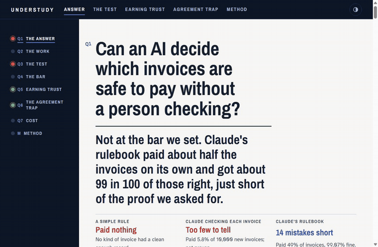

# Understudy

**Which invoices can an AI pass straight to payment, and how do you prove it first?**

Live report: https://understudy.gurn3k.com

Understudy is a findings report built on a real enterprise purchase-to-pay event log: 251,734 purchase-order lines and 1.6 million events. It finds where people spend their time, picks the most repetitive decision (whether an invoice can be paid with no one checking it), and tests three AI "understudies" for that job against what actually happened:

- **A, a plain rule** fitted on earlier months.
- **B, Claude judging each invoice** from facts known at the moment it arrived.
- **C, Claude writing a policy**: rules in a small language that code checks and then runs on every invoice.

Each understudy is held to a trust bar: the 95% lower bound on how often its straight-through calls are right must be at least 99%. An earned-autonomy replay grants autonomy per case type, week by week, only once outcomes prove it, and withdraws it when results slip. A labelled simulation shows what happens when reviewer agreement is the gate instead of outcomes.

## The result

No contender earned trust at the 99% bar. The fixed rule passes nothing. The policy Claude wrote passes 48.7% of held-out invoices at 99.07% correct, just short of the bar (lower bound 98.95%). Three independently written policies all landed between 99.07% and 99.20%. A follow-up run of B on 10,000 new invoices, pre-registered in `docs/adr/0018-b-follow-up-run.md`, did not prove 99% either: it passed 577 (5.8%) with 6 wrong, a lower bound of 97.8%, and was not separated from the written policy, which is far cheaper. The page shows the full result, including the verdict under the rule set before any run, and the cost of each approach per 1,000 invoices.

## How it was kept honest

- **Held-out data.** Order lines created June to August 2018 were locked with a checksum before any contender ran. No contender saw their outcomes. The builder used held-out outcomes three times before the last rule was written: to rank the candidate decisions, to set the 99% bar, and to score the first policy. Each use is recorded in `docs/adr/`.
- **Rules written first.** Every rule was written down before the run it governs, in `docs/adr/`. Rules that were later replaced stay on the record, with the reason and timing.
- **Checks that fail.** Every check was shown to fail on purpose before it was trusted. Fixtures with hand-worked answers are in `tests/fixtures/`.
- **Independent recount.** A second program with no shared code recounts the raw log, and its totals match.
- **Claude's output is gated in code.** Invalid or missing answers count as "leave to a person". Policies are validated before they run.
- **Fixed wording.** `tools/check_claims.mjs` confirms that every sentence fixed in the decision records appears verbatim on the page.

## Layout

| Path | What it is |
|---|---|
| `understudy/` | Parsing, analysis, the contenders, scoring, and the replay (standard-library Python) |
| `tests/` | Unit tests and fixtures: `python -m unittest` |
| `tools/` | Runners for each stage, the site build, screenshots and checks |
| `site/` | The static findings page; `site/data.json` is generated |
| `docs/` | Product brief, research, tickets and decision records (`docs/adr/`) |

## Reproduce

Requires Python 3.12+ and no third-party packages. The live Claude runs used the Claude Code command line. Their saved responses replay without calling the model.

1. Download the BPI Challenge 2019 log (see Data) into a working folder outside the repo.
2. Parse and analyse: `python -m understudy.parse <log.xes> <data_dir>`, then the steps in `tools/run_*.ps1`.
3. Score and replay: `tools/run_bc.py`, `tools/score_all.py`, `tools/run_replay.py`.
4. Build the page data: `python tools/build_site.py`, then serve `site/` with any static server.

## Data

The log is the **BPI Challenge 2019** dataset by van Dongen, B.F., published by 4TU.ResearchData under **CC BY 4.0** (DOI [10.4121/uuid:d06aff4b-79f0-45e6-8ec8-e19730c248f1](https://doi.org/10.4121/uuid:d06aff4b-79f0-45e6-8ec8-e19730c248f1)). The data was filtered and aggregated for this analysis. Order-line identifiers shown on the page are the dataset's own anonymised identifiers.

## Licences

- Code: MIT (see `LICENSE`).
- Data: CC BY 4.0, as above.
- Fonts: Archivo Narrow and Atkinson Hyperlegible, SIL Open Font License (see `site/fonts/`).

## Limits

The data is from 2018 and contains no free text. "Straight through" means no correction between the first invoice receipt and payment, so corrections after payment aren't seen. B was scored on a 1,500-invoice sample, which can't show a 99% lower bound at a 1% error rate. The agreement-gate section is a simulation with assumed reviewer behaviour. Earlier-month rates are split by order-line creation month, so 53% of them rest on outcomes that landed after the first held-out invoice arrived. Results were not recomputed with only the rates known at the time.
